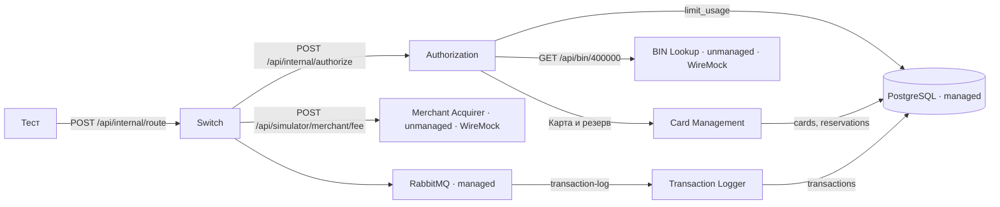

# Практика 6. Интеграционное тестирование СМП

## 1. Граница между unit- и интеграционными тестами

В практике 4 `AuthServiceImplTest` проверяет решение Authorization. Например, когда мок `upsertLimitUsage` возвращает 0, сервис отклоняет операцию и пропускает резервирование. Мок позволяет воспроизвести и отказ хранилища. Он ничего не записывает и не проверяет уникальность пары PAN и даты. В этой работе `LimitUsageRepositoryIT` выполняет тот же метод на PostgreSQL и проверяет как число затронутых строк, так и суммы после фиксации транзакции.

**Почему H2 пропускает расхождение.** Для сравнения я запустил три сценария карт в отдельной временной копии модуля на H2 2.3.232 с отключённым Flyway и `ddl-auto=create-drop`. Сохранение с последующим чтением прошло. Дубликат активного PAN вызвал ожидаемый `PanCollisionException`. Повторная выдача PAN после мягкого удаления тоже вызвала `PanCollisionException`, хотя на PostgreSQL операция прошла. Hibernate строит схему по `CardEntity`, где PAN объявлен уникальным для всей таблицы. В рабочей схеме миграция V5.8 исключает строки со статусом `DELETED` из индекса. Отдельный запуск её команды `CREATE UNIQUE INDEX ... WHERE cards.status != 'DELETED'` в H2 завершился синтаксической ошибкой 42000 на `WHERE`.

## 2. Проверки персистентности

| Участок | Действие | Что проверяется после записи |
|---|---|---|
| Карты, round-trip | Сохранить доменную карту через `CardRepository.create`, затем найти по PAN | Совпадают все поля, включая UUID, срок действия, статус, лимиты, остаток и время создания |
| Карты, уникальность | Создать две активные карты с одним PAN и разными UUID | Адаптер возвращает `PanCollisionException`, исходная карта читается без изменений |
| Карты, мягкое удаление | Обновить статус первой карты до `DELETED` и создать новую с тем же PAN | Поиск возвращает новую карту, а прямой SQL видит обе строки |
| Карты, миграции | Запустить JPA на пустом PostgreSQL | Flyway применяет V5.1–V5.8, Hibernate валидирует полученную схему |
| Лимиты, вставка и конфликт ключа | Записать 60, затем ещё 40 на ту же дату при дневном лимите 100 | Каждый вызов затрагивает одну строку. Итоговая строка одна, дневная и месячная суммы равны 100 |
| Лимиты, отказ | После 60 попытаться записать 41 при дневном лимите 100 | Запрос возвращает 0, обе суммы остаются равны 60 |
| Лимиты, перенос между датами | За пять дней исчерпать месячный лимит 500 и на шестой день запросить ещё 1 | Новая строка не появляется, накопленная сумма остаётся равна 500 |

В Authorization таблицу `limit_usage` создаёт Hibernate в режиме `ddl-auto=update`. Flyway управляет последовательностью `rrn_seq`. Тест вызывает нативный запрос с `ON CONFLICT` и `DATE_TRUNC` на схеме, которую создаёт сам сервис.

## 3. Изоляция данных и транзакций

У каждого класса свой экземпляр окружения Testcontainers. PostgreSQL и RabbitMQ используют случайные порты. Для сервисных тестов Maven сначала собирает JAR из текущего дерева, затем Testcontainers запускает их в сети данного класса. Как в основном Compose-файле, сервисы используют одну базу PostgreSQL и собственные таблицы. Во внешнем стенде данные для тестов не требуются.

Перед каждым сценарием `@BeforeEach` очищает рабочие таблицы командой `TRUNCATE ... RESTART IDENTITY CASCADE`. Справочник BIN, заполненный миграцией V5.2, сохраняется. В тестах с брокером очищаются основная очередь и DLQ. Для каждого теста создаётся новый PAN. В сквозном сценарии PAN выдаёт Card Management, STAN генерирует тест, RRN выдаёт Authorization. Для контрольного сообщения Logger тест генерирует все три ключа.

В JPA-тестах отключена общая транзакция `@DataJpaTest`. Карточный репозиторий завершает запись до чтения, каждый вызов upsert выполняется в отдельной транзакции через `TransactionTemplate`. После отклонённой записи проверка читает уже зафиксированное состояние. Асинхронные проверки опрашивают конкретную очередь или запись каждые 100 мс в пределах 5 с.

## 4. Сквозной проход



В конспекте практики для входа в Switch указан `/api/internal/authorize`. В `RouteController` точка входа — `/api/internal/route`. Запрос на `/authorize` выполняет сам Switch. Тест создаёт карту с остатком 2000 копеек и отправляет операцию на 125. После `APPROVED` проверяет STAN и RRN, обе накопленные суммы по PAN и дате, резерв `RESERVED` по PAN и RRN. Затем ждёт запись Logger с теми же RRN, STAN, PAN, суммой и комиссией 7 из ответа Merchant Acquirer. Обращение за BIN проверяется по журналу WireMock, поскольку отказ этой зависимости сам по себе не мешает одобрению.

## 5. Брокер и воспроизведение

В тесте Logger без Switch объявляются его DLX, DLQ с TTL 60 секунд и привязка. Брокер получает обрезанный JSON через `smp.transactions` с ключом `transaction.log`. Тест сразу вычитывает сообщение из DLQ, сверяет байты и причину первого помещения в DLQ (`rejected`), затем проверяет пустоту основной очереди. Трассировка RabbitMQ регистрирует доставки слушателю по ключу `deliver.transaction-log`. К моменту отклонения в трассе должна быть ровно одна доставка с исходным телом. Рабочий Switch отправляет сериализованный Java DTO через `RabbitTemplate.convertAndSend`. Контрольное сообщение использует тот же формат. Появление в PostgreSQL строки с его UUID, RRN и STAN подтверждает, что слушатель продолжил работу.

Для запуска из корня репозитория нужны работающий Docker и JDK 21 для Maven.

```sh
mvn -B -f services/pom.xml -Pintegration-tests clean verify
mvn -B -f services/pom.xml -Pintegration-tests verify
```

Классы запускает Maven Failsafe. Результаты каждого прогона доступны в `target/failsafe-reports` модулей `card-management`, `authorization` и `transaction-logger`. В GitHub Actions те же команды выполняет job `integration-tests` на одном runner.

16 ноября 2026 года обе команды завершились локально с `BUILD SUCCESS`. В каждом прогоне прошли все 9 интеграционных тестов практики: 3 для карт, 4 для лимитов, 1 для цепочки и 1 для DLQ. Ошибок и пропусков не было. Удалённый workflow не запускался.
